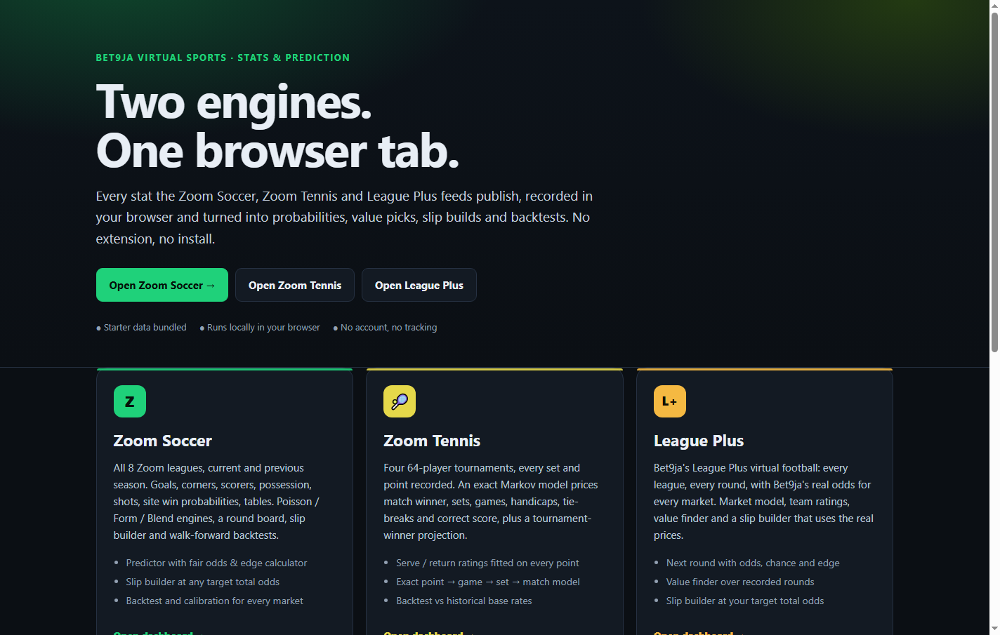
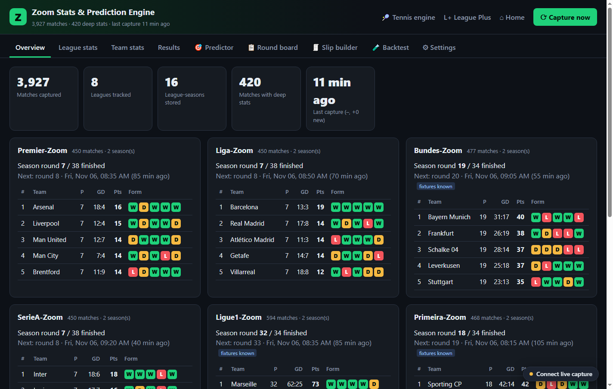
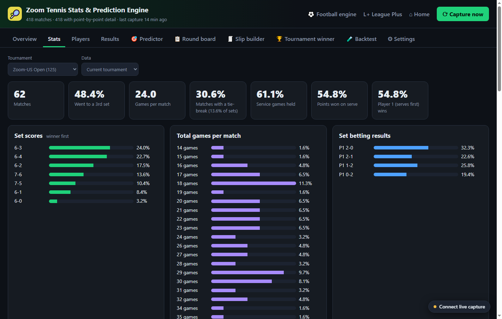
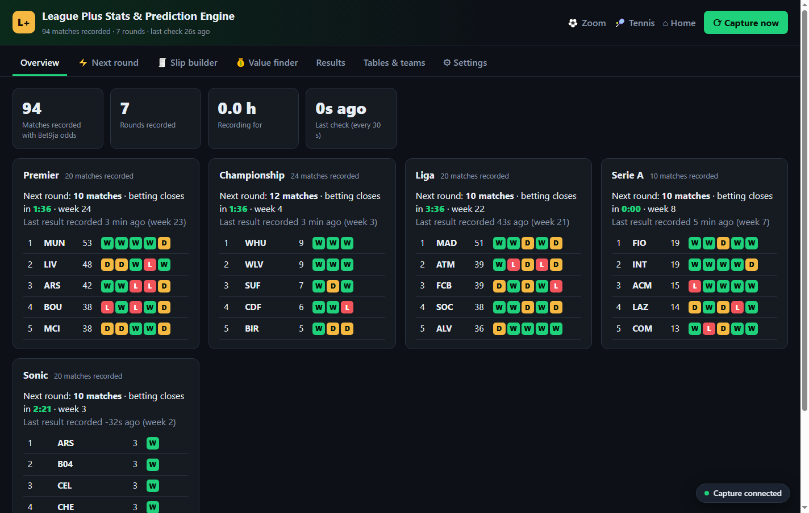
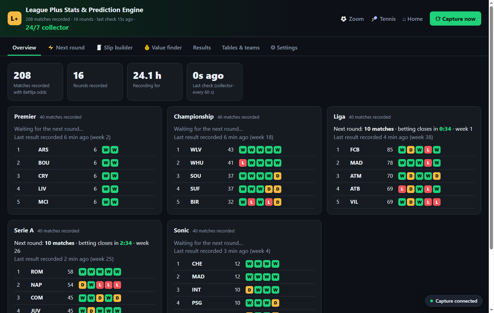

# Bet9ja Virtual Engines — hosted on GitHub Pages

> **New to GitHub or Cloudflare?** Follow the click-by-click beginner guide:
> [START-HERE.md](START-HERE.md). It covers the accounts, the upload, the collector
> deployment and the 60-second checklist.

Zoom Soccer, Zoom Tennis and League Plus stats & prediction engines, rebuilt as a normal
website. No Chrome extension, no install, no local server required to view the dashboards.

The site is plain HTML/CSS/JS: GitHub Pages can serve it directly. The engines keep their
data in the browser's IndexedDB, exactly like the extension did.

> **TL;DR** — upload this folder to a public GitHub repo → **Settings → Pages**, deploy
> `main` / root → open `https://YOUR-NAME.github.io/REPO/` → paste a Cloudflare Worker URL
> into the **Connect live capture** pill (section 2). The dashboards already work before
> that, using the bundled snapshot. For League Plus, deploy the collector in §2b and use
> its URL instead — then nothing has to stay open.



| Zoom Soccer | Zoom Tennis | League Plus |
|---|---|---|
|  |  |  |

---

## What is in the box

| Path | What it is |
|---|---|
| `index.html` | Landing page with links to the three engines |
| `zoom/` | Zoom Soccer + Zoom Tennis dashboards (the original engine code, web-adapted) |
| `leagueplus/` | League Plus dashboard |
| `shared/` | Web runtime: `chrome.*` shim, relay client, starter-data loader, capture boot |
| `seed/` | Starter databases captured from the real feeds (so every tab works on first open) |
| `proxy/worker.js` | The tiny CORS relay. Deploy once to Cloudflare Workers (free) |
| `collector/` | Optional 24/7 League Plus collector: Cloudflare Worker + D1 + cron (see §2b) |
| `scripts/` | Local server, local relay, headless browser check, seed capture |
| `proxy/wrangler.toml` | Optional CLI deployment config for the relay |

---

## 1. Put it on GitHub (5 minutes)

You need a GitHub account. A **public** repository is simplest (free GitHub Pages).

1. On GitHub click **New repository**. Name it e.g. `bet9ja-engines`, choose **Public**,
   and create it (do not add a README).
2. On the empty repository page click **Add file → Upload files**.
3. Open the `bet9ja-engines` folder on your PC and drag **everything inside it** into the
   upload area — including the `zoom`, `leagueplus`, `shared`, `seed`, `proxy` and `scripts`
   folders. Do not drag the outer folder itself.
4. Click **Commit changes**.
5. Go to **Settings → Pages**. Under **Build and deployment → Source** choose
   **Deploy from a branch**, branch **main**, folder **/(root)**, then **Save**.
6. Wait 1–2 minutes. Your site is at:

   `https://YOUR-USERNAME.github.io/bet9ja-engines/`

That is the link to share. The three dashboards are already populated with the bundled
starter data.

> If the upload page refuses folders, install **GitHub Desktop**, choose
> *File → Add local repository* on this folder, publish it, then do step 5.

---

## 2. Turn on live capture (one-time relay)

GitHub Pages can only serve static files. Bet9ja's feeds send **no CORS header**, so a page
on `github.io` is not allowed to read them. The site therefore sends API requests through a
tiny relay. The relay forwards only the five Bet9ja hosts and stores nothing.

### Cloudflare Workers (free, recommended)

1. Go to <https://dash.cloudflare.com> → **Workers & Pages** → **Create** → **Worker**.
2. Give it a name (e.g. `bet9ja-relay`) and click **Deploy**.
3. Click **Edit code**, delete the sample, and paste the whole of
   [`proxy/worker.js`](proxy/worker.js). If the editor asks for a template/syntax, choose
   **Module**. Click **Deploy**.
4. Copy the Worker URL — it looks like
   `https://bet9ja-relay.your-name.workers.dev`.
5. Open your GitHub Pages site, click the **Connect live capture** pill (bottom-right),
   paste the URL and click **Save & start capturing**.

The pill turns green. Leave a dashboard tab open: Zoom captures every ~3 minutes, Tennis
every ~5 minutes, League Plus every ~20 seconds.

### If Cloudflare is blocked

Some networks/Akamai configurations reject datacenter IPs. The relay test will say
`403`/`Access Denied`. Two fallbacks:

* **Run the relay on your own PC** (Node 18+):
  ```
  cd bet9ja-engines
  node scripts/proxy-local.mjs
  ```
  Then paste `http://127.0.0.1:8787` into the relay dialog. Keep the terminal open.
  (Chrome/Edge allow an HTTPS page to call loopback; if your browser does not, use
  `node scripts/serve.mjs` and open `http://127.0.0.1:8080` locally.)

* Deploy the same `proxy/worker.js` to another Workers-compatible host (Deno Deploy,
  Vercel Edge Functions, etc.). The code is a standard `fetch` handler.

### Optional: deploy the relay with Wrangler

```
cd proxy
npx wrangler deploy
```

---

## 2b. 24/7 League Plus collector (optional)

**Only League Plus needs this.** Zoom Soccer and Zoom Tennis keep the current and previous
season on their feeds, so they can catch up whenever you open the page. League Plus exposes
only the open round and the last finished one — if nothing is running for an hour, those
rounds are gone forever.

`collector/` is a Cloudflare Worker that runs on a cron trigger every minute, stores every
finished League Plus round in a D1 database, and serves it to the site. Once deployed:

- no computer or browser has to be open for League Plus to keep recording;
- the same Worker URL also acts as the CORS relay, so you do **not** need `proxy/worker.js`
  separately;
- the site loads the last ~60 rounds (~1.5 hours) on first visit, then asks only for new
  rounds every 60 seconds;
- 30 days of rounds are kept, which is plenty for team ratings, value and backtests.

A round finishes roughly every 6 minutes. The cron runs every minute, so it catches each
one; if the Worker is disabled or failing for more than ~6 minutes, that round is missed
(the feed never re-publishes it).



### Deploy it (CLI, ~5 minutes)

You need Node 22+ and a free Cloudflare account. On Windows PowerShell the `.ps1` npm/npx
shims are often blocked by the execution policy, so use `npm.cmd` / `npx.cmd` (on macOS and
Linux drop the `.cmd`).

```
cd collector
npm.cmd install
npx.cmd wrangler login
npx.cmd wrangler d1 create bet9ja-collector
```

`d1 create` prints a `database_id`. Open `collector/wrangler.toml` and replace the
`00000000-0000-0000-0000-000000000000` placeholder with it. Then:

```
npx.cmd wrangler d1 migrations apply bet9ja-collector --remote
npx.cmd wrangler deploy
```

Copy the deployed URL (e.g. `https://bet9ja-collector.your-name.workers.dev`) and paste it
into the site's **Connect live capture** pill — the same field as the relay. Open the
League Plus dashboard: the header should say **24/7 collector**, and
`https://YOUR-WORKER.workers.dev/api/lp/status` should show `rounds` growing and
`lastError: null`.

The first round appears within ~2 minutes. The cron trigger is in `wrangler.toml`
(`crons = ["* * * * *"]`); `wrangler deploy` registers it automatically.

### If you prefer the Cloudflare dashboard

The D1 database, the `DB` binding and the cron trigger can be created in the dashboard, but
the Worker should still be deployed with `npx wrangler deploy`. The source is split across
`worker.js`, `collect.js`, `lp.js`, `db.js`, `relay.js` and `http.js`; Wrangler bundles them
into the single module Cloudflare runs. Copy-pasting only `worker.js` will fail on the
imports.

If you create D1 in the dashboard, run
[`collector/migrations/0001_init.sql`](collector/migrations/0001_init.sql) in its console,
bind it to the Worker as `DB`, add a Cron Trigger `* * * * *`, and put the same
`database_id` into `wrangler.toml` so the two agree.

### Local test

```
cd collector
npm.cmd install
npx.cmd wrangler d1 migrations apply bet9ja-collector --local
npm.cmd run dev
```

Then, in another terminal:

```
curl "http://127.0.0.1:8788/__scheduled?cron=*+*+*+*+*"
curl "http://127.0.0.1:8788/api/lp/status"
```

Use `http://127.0.0.1:8788` as the relay URL on the League Plus page; it should switch to
collector mode. The local D1 state lives in `collector/.wrangler/` and is ignored by git.

### API

| Endpoint | Purpose |
|---|---|
| `/api/lp/status` | Service name, round count, last round, last error |
| `/api/lp?rounds=120` | Last N rounds + init, open round, standings || `/api/lp?since=<ts>` | Only rounds newer than a timestamp (incremental polling) |
| `/api/lp/state` | Init, open round and standings only |
| `/api/health` | Liveness |
| `/?url=<bet9ja-api>` | The CORS relay (same allow-list as `proxy/worker.js`) |

Free-plan usage is comfortably inside the limits: ~1,440 cron invocations/day,
~8,000 D1 writes/day, and a few hundred MB of 30-day storage.

If `/api/lp/status` shows a `lastError`, Bet9ja/Akamai refused Cloudflare's datacenter IP
(the same risk as the plain relay). The site falls back to browser capture when it cannot
detect a collector, and the local relay fallback still works.

---

## 3. Using the engines

Open a dashboard. Zoom Soccer and Zoom Tennis record while the tab is open. League Plus
does the same unless the optional collector (§2b) is configured — then the Worker records
it 24/7 and the page only loads snapshots. Data is stored per browser in IndexedDB, so it
is private to that browser profile. Use **Settings → Export full backup** regularly; import
it on another device or after clearing site data.

* **Zoom Soccer** — Overview, League stats, Team stats, Results, Predictor, Round board,
  Slip builder, Backtest, Settings.
* **Zoom Tennis** — Overview, Stats, Players, Results, Predictor, Round board, Slip builder,
  Tournament winner, Backtest, Settings.
* **League Plus** — Overview, Next round, Slip builder, Value finder, Results, Tables & teams,
  Settings. The header says **24/7 collector** when §2b is active.

Starter data is a **snapshot**, taken when this folder was built. Until a data source is
connected, the Next round / Round board / Slip builder show the round that was open at
snapshot time (it will have closed since). Once the relay or collector is connected, the
page refreshes the open round automatically.

League Plus's API keeps no history at all. With the collector it records every round 24/7;
without it, its database only grows while a League Plus tab is open. Zoom and Tennis can
backfill the current and previous season from the feed whenever you open them.

### What is not in the hosted build

**Live in-play** (Zoom football/tennis live tab). The extension captured it by injecting a
script into the Bet9ja page and reading that page's internal push-feed store. A normal
website cannot read another origin's page state, so live in-play is not available here.
Everything else — history, tables, ratings, pre-match predictions, value, slips, backtests —
works.

---

## 4. Local development

```
node scripts/serve.mjs        # http://127.0.0.1:8080
node scripts/proxy-local.mjs  # http://127.0.0.1:8787
```

The first page load copies the bundled seed (~2.5 MB) into IndexedDB, which takes a
second or two. To test a tab:

```
node scripts/check-page.mjs "http://127.0.0.1:8080/zoom/dashboard.html" 12000 shot.png backtest
```

### Regenerate the starter data

From the project root (needs internet and a browser-like User-Agent; the script supplies one):

```
node scripts/capture.mjs                       # all three engines
node scripts/capture.mjs --only=zoom --deep=400
node scripts/capture.mjs --only=tennis --details=400
node scripts/capture.mjs --only=leagueplus
```

This reuses the engines' own parsing and sync code with an in-memory IndexedDB, then writes
`seed/zoom.json`, `seed/tennis.json` and `seed/leagueplus.json`. Commit the updated files;
the site picks them up on the next visit (only when a browser has no data yet — to force a
reload, use Settings → Clear database and refresh).

### Files worth knowing

* `shared/chrome-shim.js` — implements `chrome.storage`, `chrome.runtime.sendMessage`,
  `chrome.alarms` and `chrome.tabs` on top of IndexedDB.
* `shared/net.js` — the only place API requests are made; uses the configured relay.
* `shared/boot-*.js` — replaces the extension's background service worker: seeds the DB,
  schedules captures, answers dashboard messages.
* `zoom/lib/api.js`, `leagueplus/lib/core.js`, `zoom/tennis/lib/tcore.js` — the three API
  clients, rewritten to call `EngineNet`.

---

## 5. Troubleshooting

| Symptom | Fix |
|---|---|
| Page loads but shows “No data yet” | Hard-refresh (Ctrl+F5). Check the browser console; the seed files must be reachable at `/seed/*.json`. |
| Relay test: `403` / `Access Denied` | Bet9ja (Akamai) rejected the relay's IP. Use the local relay fallback above. |
| Capture status says `No data relay configured` | Click the pill and save the Worker URL. |
| League Plus does not say **24/7 collector** | Open `https://YOUR-WORKER.workers.dev/api/lp/status`; it must return `service: "bet9ja-collector"`. Check the D1 binding is named `DB` and the schema migration ran. |
| `/api/lp/status` shows `lastError` | Bet9ja/Akamai refused Cloudflare's egress, or the D1 schema is missing. If it is a 403, use the local relay fallback. |
| League Plus says “No matches available” in Slip builder | The bundled upcoming round has closed. Connect the relay or collector so the page refreshes the open round. |
| GitHub Pages shows 404 | Wait for the first Pages build; confirm Settings → Pages points at `main` / root. |
| Storage quota / slow browser | IndexedDB grows with history. Export a backup, then Settings → Clear database. |

---

## 6. What changed from the extension

* **`chrome.*` APIs** — `shared/chrome-shim.js` implements `storage.local/session`,
  `runtime.sendMessage`, `alarms` and `tabs` on top of IndexedDB and timers, so the engine
  code runs unmodified in a page.
* **Background worker** — `shared/boot-zoom.js`, `boot-tennis.js` and `boot-leagueplus.js`
  replace the service worker. They load the seed, answer dashboard messages, and schedule
  capture while the tab is open.
* **API access** — the three API clients call `EngineNet.call()` instead of `fetch`, which
  routes through the relay (or fails with a clear “No data relay configured” message).
* **Starter data** — `seed/*.json` is copied into IndexedDB on first visit, so the
  dashboards are populated before any live capture.
* **24/7 collector** — `collector/` is an optional Cloudflare Worker + D1 database that
  records League Plus every minute and serves snapshots. The page detects it automatically
  from `/api/lp/status` and then stops doing its own League Plus capture. The same Worker
  also implements the CORS relay.
* **Live in-play removed** — the extension injected content scripts into the Bet9ja page to
  read its internal store. A website cannot do that cross-origin. The Live tabs and live
  backtest button are gone; the in-play engine files are still present but unused.

---

## 7. Disclaimer

Unofficial project. Not affiliated with Bet9ja. All match data and odds belong to Bet9ja
and are read from its public feeds. These engines are statistical tools: bookmakers build a
margin into every price, and no model guarantees a profit. Use the Backtest and Value tabs,
stake responsibly, 18+.

Code in this repository is provided as-is under the MIT licence; the data is not.
